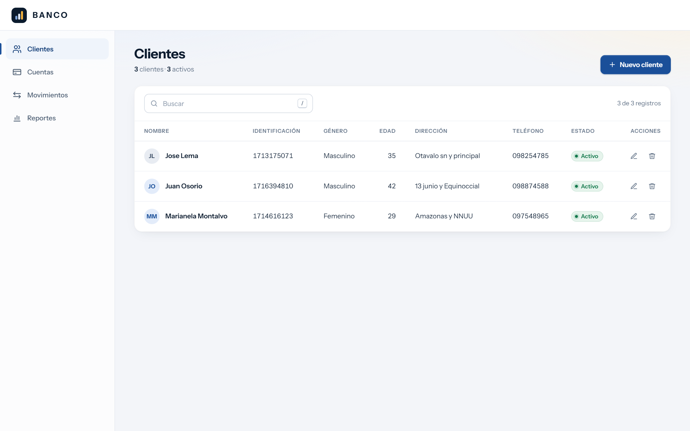
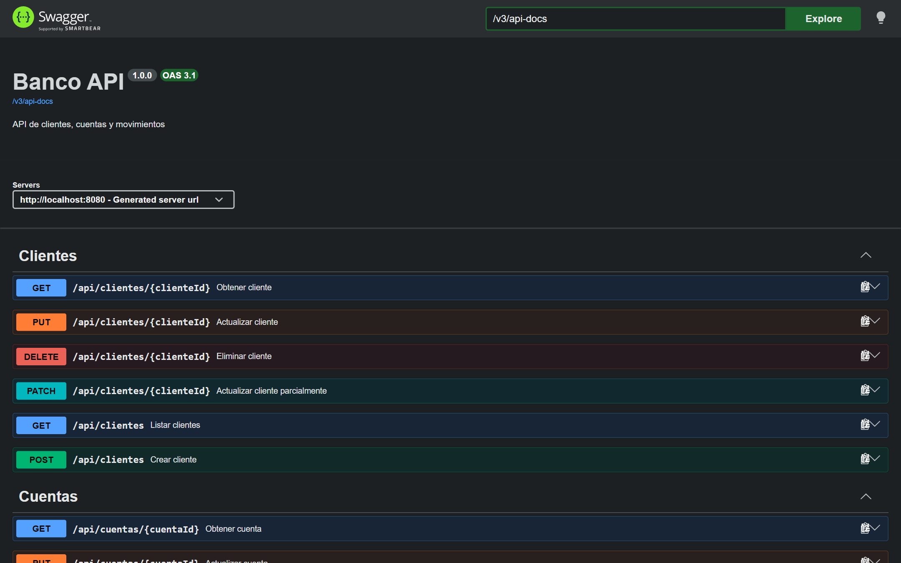
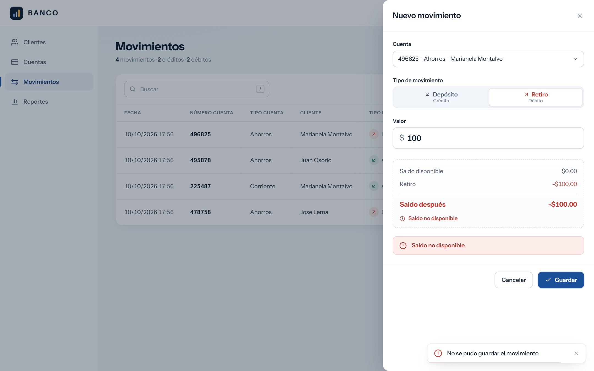
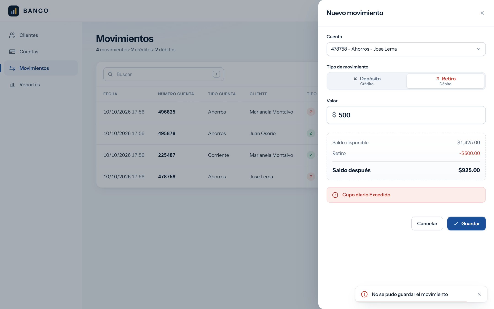
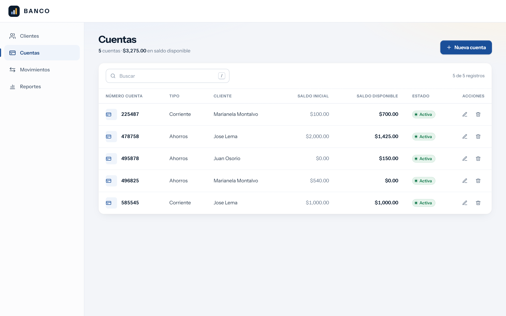
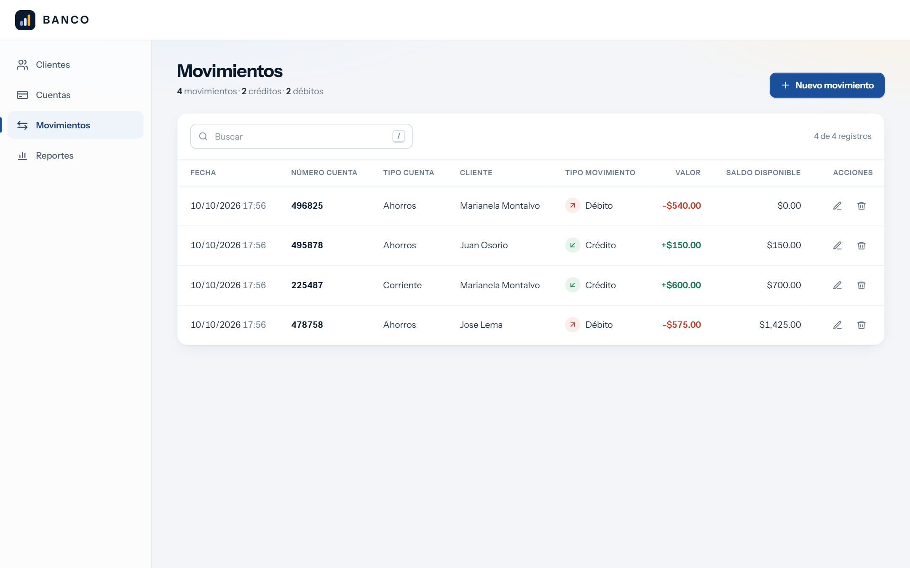
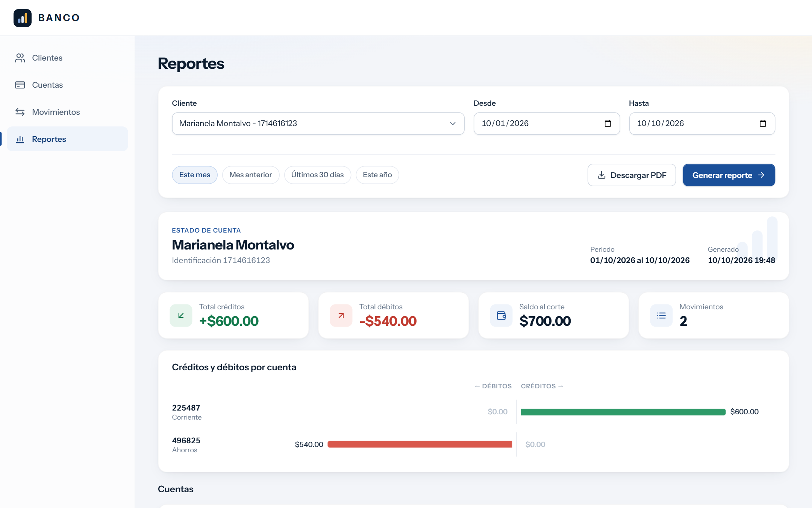
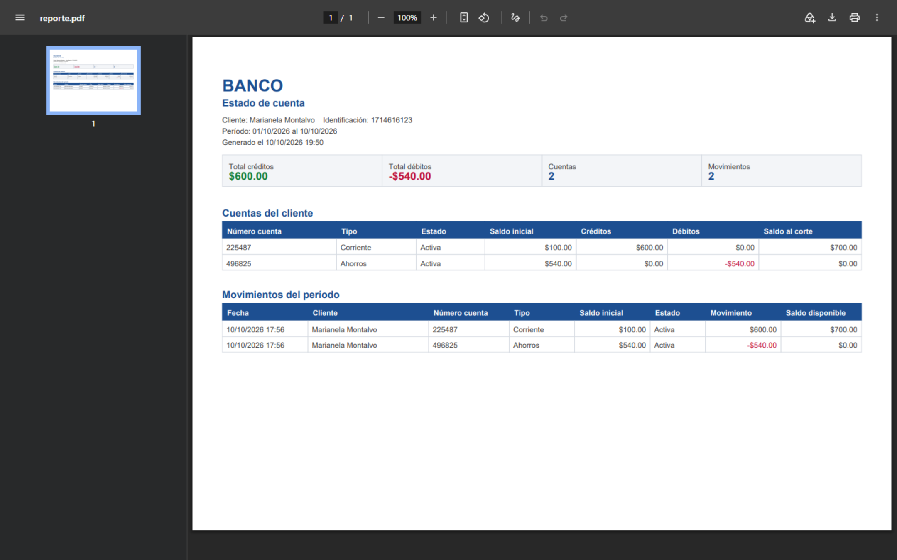
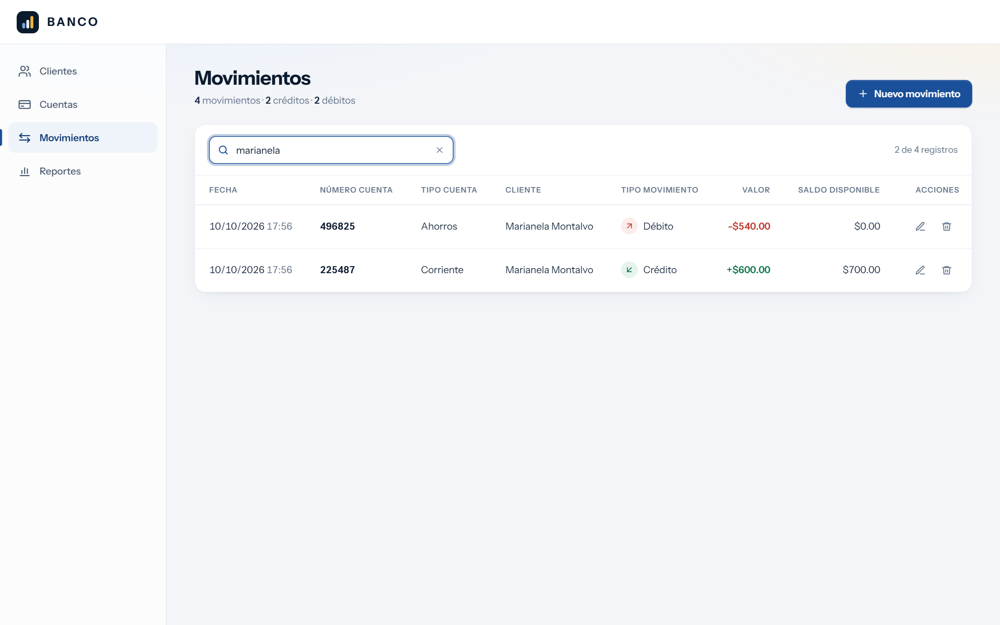
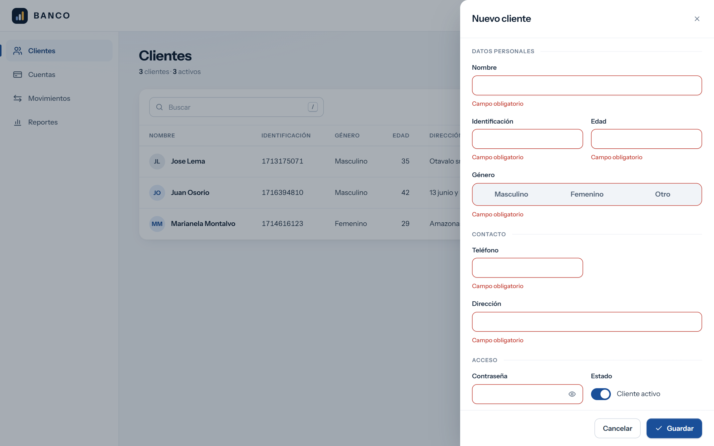

# Banco

[](https://github.com/RALC365/devsu-prueba-tecnica-full-stack/actions/workflows/ci.yml)

Prueba técnica Full Stack (Java + Angular). API REST en Spring Boot para clientes, cuentas y movimientos, con estado de cuenta en JSON y PDF, y un frontend en Angular que la consume.



## Levantarlo (opcional, para revalidar)

Solo hace falta Docker. No hay que crear `.env`.

```bash
docker compose up -d --build
```

| Qué | Dónde |
|---|---|
| Aplicación | http://localhost:4200 |
| API | http://localhost:8080/api |
| Swagger | http://localhost:8080/swagger-ui.html |

Los datos de los casos de uso se cargan ejecutando en orden la colección `postman/Banco-API.postman_collection.json` (Runner de Postman) o con `npx newman run postman/Banco-API.postman_collection.json`.

## Checklist del enunciado

### Indicaciones generales

**Backend**

- [x] Buenas prácticas y patrones: capas controller, service y repository; Repository con Spring Data JPA; DTOs con mappers; Strategy y Factory para los tipos de movimiento.
- [x] Entidades con JPA (Hibernate).
- [x] Mensajes de excepciones: un `@RestControllerAdvice` devuelve cada error como Problem Details (RFC 9457) con un `codigo` y el detalle por campo.
- [x] Pruebas unitarias de endpoints: `ClienteControllerTest`, `CuentaControllerTest`, `MovimientoControllerTest` y `ReporteControllerTest`, dentro de 132 pruebas del backend.
- [x] Desplegado en Docker.

**Frontend**

- [x] Buenas prácticas (clean code, SOLID): componentes standalone, un store genérico para los CRUD, un interceptor para los errores y formularios tipados.
- [x] Pruebas unitarias con Jest: 172 pruebas, 95 % de cobertura.
- [x] Sin frameworks de estilos ni componentes prefabricados: todo el CSS es propio.

### Entidades

- [x] Persona: nombre, género, edad, identificación, dirección y teléfono, con su PK.
- [x] Cliente hereda de Persona (herencia JOINED): clienteId, contraseña (guardada con BCrypt) y estado, con su PK.
- [x] Cuenta: número, tipo, saldo inicial y estado, con su PK. El número de cuenta es único.
- [x] Movimiento: fecha, tipo, valor y saldo, con su PK.

### Funcionalidades del backend

- [x] CRUD con GET, POST, PUT, PATCH y DELETE en `/api/clientes`, `/api/cuentas` y `/api/movimientos`.

  

- [x] Los créditos se guardan en positivo y los débitos en negativo; cada movimiento guarda el saldo disponible con el que queda la cuenta.
- [x] Débito sin saldo: "Saldo no disponible". El formulario lo anticipa antes de guardar y el recuadro rojo es la respuesta de la API.

  

- [x] Límite de retiro diario de 1000 como parámetro (`BANCO_LIMITE_DIARIO_RETIRO`). Al superarlo: "Cupo diario Excedido".

  

- [x] Estado de cuenta por cliente y rango de fechas, con las cuentas, sus saldos y el total de créditos y débitos, en JSON y en PDF (base64):
  - `GET /api/reportes?clienteId=2&fechaInicio=2026-10-01&fechaFin=2026-10-10`
  - `GET /api/reportes/pdf` con los mismos parámetros

  Cada movimiento del reporte trae los campos del ejemplo del enunciado:

  ```json
  {
    "fecha": "2026-10-10T17:56:09",
    "cliente": "Marianela Montalvo",
    "numeroCuenta": "225487",
    "tipoCuenta": "CORRIENTE",
    "saldoInicial": 100,
    "estado": true,
    "tipoMovimiento": "CREDITO",
    "movimiento": 600,
    "saldoDisponible": 700
  }
  ```

### Casos de uso

- [x] Los cinco casos del enunciado (usuarios, cuentas, la nueva cuenta corriente de Jose Lema, los movimientos y el listado por fechas) se crean al correr la colección de Postman. También están en la prueba de integración `CasosDeUsoIntegrationTest`.

  

  

### Funcionalidades del frontend

- [x] Layout del mockup adaptado: encabezado, menú lateral y una pantalla por entidad (captura de arriba).
- [x] CRUD de clientes, cuentas y movimientos: crear y editar en un panel lateral, eliminar con confirmación.
- [x] Reporte visual con resumen, gráfico y tablas, y botón para descargar el PDF.

  

  

- [x] Búsqueda rápida en todas las tablas, por cualquier columna.

  

- [x] Mensajes de validación en pantalla, tanto los del formulario como los que devuelve la API (capturas de saldo y cupo).

  

### Extras

- [x] Lambdas y programación funcional: streams y Optional en el backend; signals y RxJS en el frontend.
- [x] Exception handlers (`@RestControllerAdvice`).
- [x] Validación de atributos a nivel de modelo con Bean Validation, más validadores propios.
- [x] Patrones de diseño: Strategy, Factory, Repository y MVC.

### Despliegue y entregables

- [x] `BaseDatos.sql` con el esquema completo; PostgreSQL lo ejecuta al crear el contenedor.
- [x] Solución desplegada con Docker Compose (base, API y frontend).
- [x] Colección de Postman con 52 peticiones y 105 verificaciones. El workflow de GitHub Actions la corre contra Docker en cada push.
- [x] Repositorio público, .zip y JSON de Postman.

## Pruebas

```bash
cd backend && ./mvnw verify   # 132 pruebas; falla si la cobertura baja del 85 %
cd frontend && npm test       # 172 pruebas con Jest
```

## Sin Docker

Backend con JDK 21 (usa la base del contenedor en `localhost:5433`) y frontend con Node 24:

```bash
docker compose up -d db
cd backend && ./mvnw spring-boot:run
cd frontend && npm install && npm start
```
